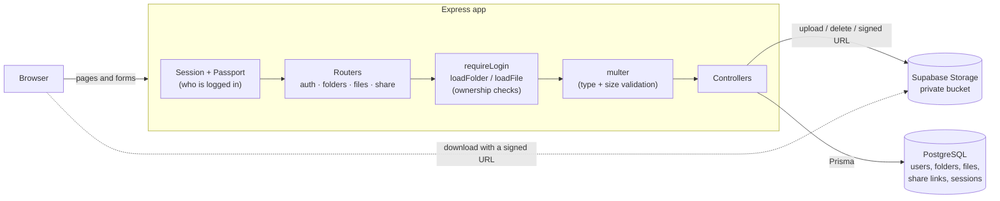
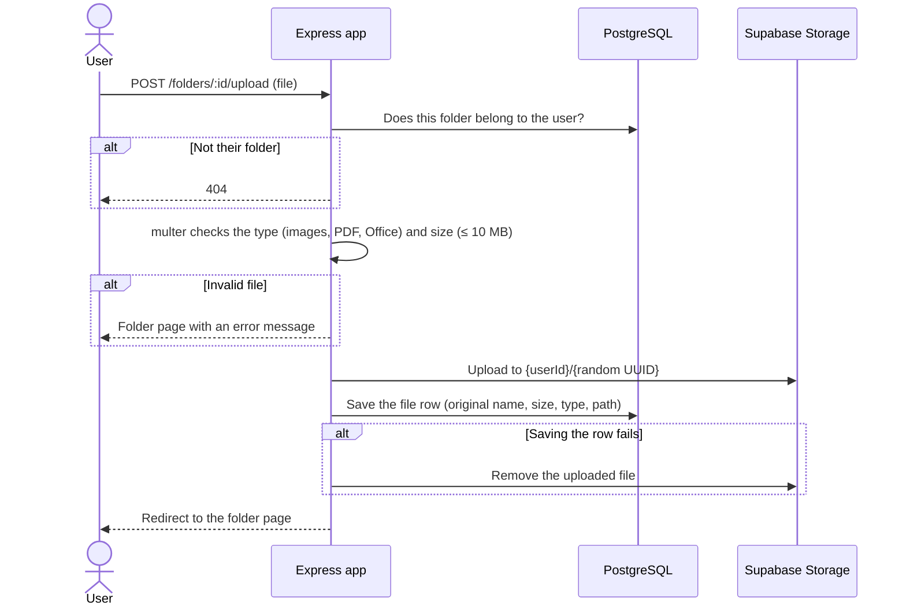
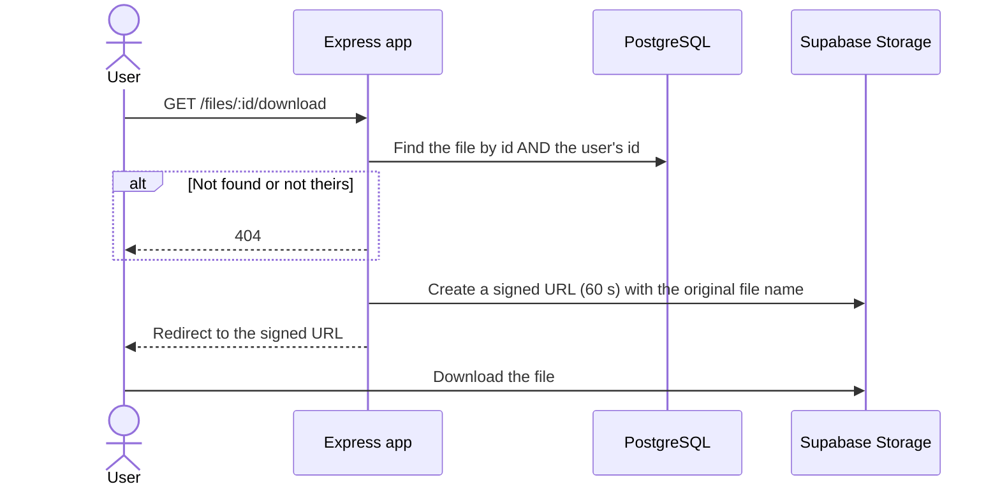
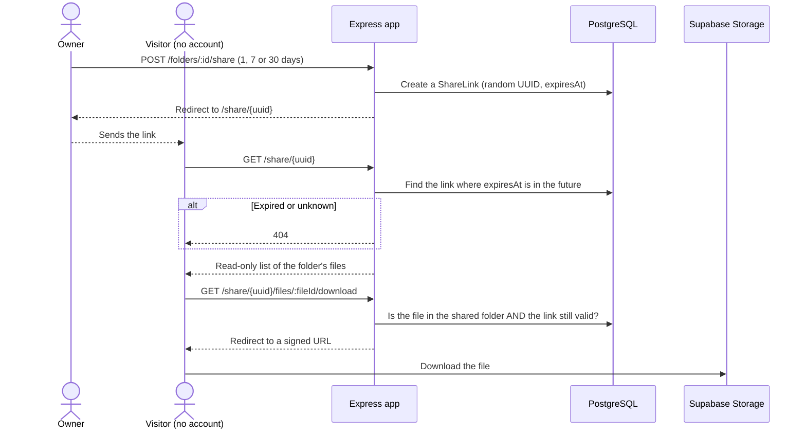
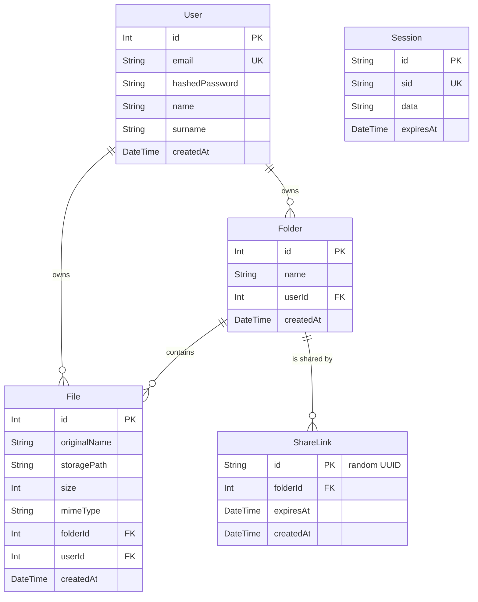

# File Uploader

A small personal file storage app, a stripped-down Google Drive, built for [The Odin Project](https://www.theodinproject.com/lessons/nodejs-file-uploader). Users keep files in folders, download them, and share a folder with anyone through a link that expires.

## Features

- Sign up and log in with sessions that are stored in PostgreSQL through Prisma
- Passwords are hashed with bcrypt
- Create, rename and delete folders
- Upload files into a folder, then see their details and download them
- Files are stored in Supabase Storage in a private bucket, and downloads use signed links that work for 60 seconds
- Only images, PDF, Word, Excel and PowerPoint files up to 10 MB can be uploaded
- Share a folder for 1, 7 or 30 days. Anyone with the link can see and download its files without an account
- File names in any language (for example `Rüstəm qeyd.pdf`) are kept and downloaded correctly

## Security

- Every folder and file query includes the logged-in user's id, so one user can never open, download or delete another user's files. Other users' folders and files return 404.
- Share links use a random UUID, so they can't be guessed. A link only gives access to the files of its own folder, and it stops working when it expires.
- The Supabase secret key is only used on the server. The bucket is private, so files can only be reached through a signed link that the app creates after checking access.

## Tech stack

- **Node.js 24** and **Express 5**, written in **TypeScript** (run directly by Node in development)
- **PostgreSQL** with **Prisma 7** and the `@prisma/adapter-pg` driver adapter
- **Passport** (local strategy), **express-session** and **@quixo3/prisma-session-store** for authentication
- **multer** for uploads and **Supabase Storage** for the files
- **express-validator** for form validation
- **EJS** templates and **Tailwind CSS**

## How it works

### Overview

The app server checks who you are and what you're allowed to see. File data lives in Supabase Storage, and everything else lives in PostgreSQL.



### Uploading a file



### Downloading a file

The app never sends the file itself. It checks access, then sends the browser to a signed link that works for 60 seconds.



### Sharing a folder



## Database



- Emails are unique and saved in lowercase
- Folder names are unique per user
- Deleting a folder deletes its files and share links (`ON DELETE CASCADE`), and deleting a user deletes everything they own. When a file or folder is deleted, the app also removes the stored files from Supabase Storage.
- `storagePath` is the file's path in the bucket (`<userId>/<random UUID>`). The original name is only stored in `originalName`.
- The `Session` table holds the login sessions

## Running locally

Requirements: Node.js 24, a PostgreSQL database and a Supabase project.

1. Install the dependencies:

   ```bash
   npm install
   ```

2. In Supabase, create a **private** bucket under **Storage**. Then copy the project URL and a secret key from **Project Settings → API Keys**.

3. Copy the example environment file, then fill in the values:

   ```bash
   cp .env.example .env
   ```

   | Variable | What it is |
   | --- | --- |
   | `DATABASE_URL` | The PostgreSQL connection string |
   | `AUTH_SECRET` | A long random string used to sign session cookies |
   | `SUPABASE_URL` | The Supabase project URL |
   | `SUPABASE_SECRET_KEY` | A Supabase secret key (server only, never share it) |
   | `SUPABASE_BUCKET` | The name of the bucket |
   | `PORT` | Optional, defaults to 3000 |

4. Create the tables and generate the Prisma client:

   ```bash
   npx prisma migrate dev
   npx prisma generate
   ```

5. Build the CSS and start the server:

   ```bash
   npm run build:css
   npm run dev
   ```

   Open http://localhost:3000 (or the `PORT` you set). While working on styles, run `npm run watch:css` in a second terminal.

## Scripts

| Script | What it does |
| --- | --- |
| `npm run dev` | Start the server and restart on file changes |
| `npm run typecheck` | Check types with TypeScript |
| `npm run build:css` | Build the CSS once |
| `npm run watch:css` | Rebuild the CSS on file changes |
| `npm run build` | Compile TypeScript to `dist/` and build the CSS |
| `npm start` | Run the compiled app from `dist/` |

## Deployment

The app can run on any Node.js host with a PostgreSQL database.

- Build command: `npm install --include=dev && npx prisma generate && npm run build`
- Pre-deploy command: `npx prisma migrate deploy`
- Start command: `npm start`
- Environment variables: `DATABASE_URL`, `AUTH_SECRET`, `SUPABASE_URL`, `SUPABASE_SECRET_KEY`, `SUPABASE_BUCKET`, `NODE_ENV=production`

`prisma migrate deploy` applies any new migrations to the production database and never resets it. With `NODE_ENV=production`, the session cookie is only sent over HTTPS, so the site must be served over HTTPS for login to work.
